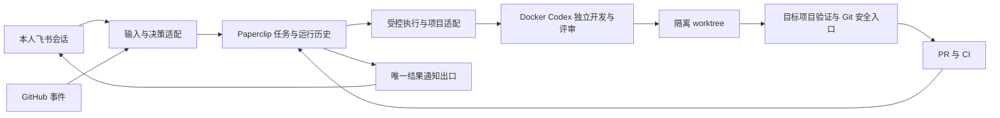

# Paperclip 集成架构

## 2026-11-22：20次原根预算与开发接线

普通原任务的Chief、执行、QA及续接共享20次外层调用；可信历史12次和第七次QA专项继续可读，显式Owner授额可提高原根而不改写已花调用。业务交付和预算登记是不同事实，运行切换与实际续接另取现场证据。

RWB采用与直接Codex相同的项目开发授权：源码、独立worktree、规则、检查及受管Git入口登记在Native workspace，项目catalog明确动作范围，不再以Agent身份额外截断为PR。自动合并仍需项目本身的独立评审、检查和分支保护；生产部署不由普通开发登记自动授予。

`team-dispatch-control`提供已认证Owner的暂停/恢复管理；`register-rwb-development`建立保留式代码workspace登记；`resume-completed-team`仅对本人明确确认原目标未完成、已结清的done原根建立新输入代际。旧flow、QA、summary、通知和预算保持原字节，新代由原coordinator消费，不创建替代根、不重放旧调用。

## 当前执行合同

Paperclip继续拥有任务、运行、会话及正式重试。当前业务模型使用Mac原生Codex、个人订阅gpt-6.1-sol/low、无沙盒和approvalPolicy=never；Docker保留App、依赖、离线测试及按需项目执行。下方标注早期Docker基线的记录不代表当前模型执行位置。全局单执行、原调用计数和未知结果核对保留。

真实工作中发现的岗位、工具和流程缺口沿[Agent迭代](agent-iteration.md)修复。普通QA NEEDS_WORK由既有Native推进流程回交同一执行任务，再由独立QA复核，不创建第二个调度器或重置根预算。普通原根默认20次，历史显式12次及QA专项按可信绑定保留；两轮质量修复与每run64 responses限制不变。

RWB普通开发按项目自身持续授权及已登记的交付范围执行，通过原GitSafety、独立评审、必需检查和分支保护后可合并。本人已授权历史有效改动按批发布时，任务绑定的DevOps发布能力仍须精确登记才可调用原RWB GitSafety/resident流程；inspect不执行会合并的delivery status，未知副作用只核对原操作，服务切换需交接当前写窗口。生产发布权限不来自岗位描述、仓库正文或模型参数。

已登记的`workspace.prepare`、`delivery.prepareCandidate`及交付命令在宿主执行时复用`hostProxyEnvironment`，读取现有代理环境或macOS系统loopback HTTPS代理，并保留本地服务的`NO_PROXY`。这覆盖模型启动前的GitSafety源码准备，不依赖随后模型broker的代理初始化；项目命令范围、超时、退出码和脱敏处理仍沿原合同。

代码任务区分三个位置：Native登记的只读源码输入目录、固定`/paperclip/.../_default`产物目录，以及宿主原GitSafety创建的隔离`codeHostPath`。输入目录由fresh Native DB工作区和Owner登记共同绑定，按实际`paperclipWorkspace.workspaceId/projectId/cwd`核验；不能直接用请求cwd作为许可，也不把源码目录的Git校验当作产物目录验收。产物执行投影、permit和Host cwd继续固定，`/workspace/project`单独映射代码工作树。

Mac 原生 provider 通道采用每 run 的 loopback HTTPS、任务 CA 与原 broker 校验；CLI 与 Node MCP 各自获得对应信任，TLS 实际监听后才可消费就绪记录。原首计划已启动 CLI 但在 HTTPS-origin 检查前未发模型 response 的已结算失败，通过窄的第二次 Native retry 合同恢复，保留旧失败与原根预算；不改写 Native NoProvider 字段。见[原生 HTTPS 与首计划恢复](plans/native-https-recovery.md)。

## 当前原生执行改造

固定安装版Agent路由将Zod投影后的AI绑定与JSONB对象作字符串比较，键顺序不同会误触发订阅变更验证。`role-ai-binding-hook`在进程内按精确源SHA将唯一比较替换为语义深比较；真实绑定变化、兼容性、身份和认证校验全部保留，安装包磁盘不修改。`loadServer`先装ChiefWeb hook、再装AI hook，统一导入、验证和逆序注销，避免提前缓存其他模式的待修改模块。

公司Skill本地导入和版本快照创建是两个原生操作。运行选择仅使用已核验的currentVersion；后端批准的公司workspace暂存与实际快照字段保持一致，不将工作区路径拒绝解释为需要关闭访问控制。

2026-11-20本人选定Mac原生Agent＋按需Docker，取代下文旧基线中的Docker模型执行默认。Paperclip仍拥有任务、订阅、运行和恢复历史；最终执行器、公司Skill分配及职责权限见[原生执行和技能分配](plans/native-skills-20261120.md)。可信策略进入当次permit，真实宿主路径、每run订阅broker和Skill快照进入原生Codex。原Docker模式显式保留供兼容与回退，不能在未知模型结果后自动切换执行器。

## 通用角色、项目与能力

新增Document Specialist的12岗定义与工具链见[文档岗合同](plans/document-specialist.md)。原11岗不重建；本岗公司技能承载文件格式方法，Native产物仍用md/json清单与独立QA绑定。文档工具仅作用于本岗子进程，既有任务、项目上界、M2知识和根预算保持。

11角色的职责与专业方法属于岗位，仓库、工作树、规则、checks和交付方式属于当前Native项目。合法项目扩展存放于`project_workspaces.metadata.superAgentProject`，通过原Native API登记；固定安装版的`runtimeConfig`是严格运行环境schema，不承载这份扩展。本人明确项目优先，其次当前/父任务项目，歧义才询问。旧M1记录继续保留。

`role-capabilities.mjs`同时生成岗位说明的能力索引和执行组合。原tools类别保留兼容；实际MCP由岗位默认与任务补充解析，并在broker处按真实目录过滤和校验。GitHub访问绑定本次项目仓库，宿主动作绑定Native许可中的动作ID。AGENTS与Skills提供方法，不能通过文字扩大允许调用范围。

模型继续在独立Docker运行。Native默认目录存放计划/报告/QA等产物；任务Git工作树另挂到`/workspace/project`，QA只读。宿主Git、checks、受管发布与选定本地MCP通过本run stdio MCP及既有宿主传输执行，Task容器只持有opaque token。宿主和provider的真实认证保持原归属。

Skill方法包单独只读挂载，保留包内相对引用与摘要；CODEX_HOME/skills只建立选定入口。运行中实际tools/list、调用结果和缺依赖原因是可用性证据。参见[实施与接口](plans/role-capabilities.md)及[岗位说明](team.md)。

Skill条目的`entrypointSha256`对应入口`SKILL.md`实际文件字节；`fileSetSha256`与保留兼容的`source.sha256`对应files清单的聚合摘要，两者不能跨类型比较。CAPABILITIES与Native提示分别明确这两种摘要。项目规则按实际提供的AGENTS或其他文档读取，未提供AGENTS文件名本身不阻断只读验证；项目明示的必需规则仍须遵循。

新派发intent逐项保存实际`renderedDescription`，创建和恢复严格复用该文本。缺此字段的旧intent仍按其原project/legacy描述重放，不重写旧Native子任务或历史；提示澄清不会使已创建的旧子任务失去恢复依据。

受控模式关闭Native全局heartbeat scheduler时，官方retry-now只将原重试提升为queued。现有team tick在旧锁/active早退前，仅将全局唯一、当前lease登记work-step的queued重试交给Native `resumeQueuedRunsForAgent`；不提升scheduled、不创建任务/run或另一队列。Native claim和后续执行仍走原消费者与retry binder的完整校验。事前选择与Native claim非原子，返回非目标ID时记录unknown并停止，不生成补偿run；Native完成阶段原有后续pump保持其生命周期。

角色指令使用Paperclip原生Managed bundle，每个角色只登记自己的`<role>/AGENTS.md`。原生文件服务的进程内装配保留认证与内容冲突检查，保存前保全旧内容，保存后同步本项目材料manifest和摘要。同步尚未完成时拒绝新执行，恢复仍核对同一次修改；旧角色配置、UUID材料和运行记录保留。参见[角色指令迁移](plans/role-instructions.md)。

## 组件与数据流

这是目标组件边界，不能据图认定已部署或通过验收。Paperclip 拥有任务和运行历史，适配层仅保存外部事件、执行许可、租约和结果的幂等关联，不建立竞争调度引擎。

## 本仓库实现、运行候选与目标

| 能力 | 本仓库基线 | 实际运行观察 / 目标 |
|---|---|---|
| 固定 Paperclip、PostgreSQL、网关、Docker 与专用卷 | 已有启动、完整性与来源保护代码 | 实际运行候选从独立集成目录启动，必须另核对 |
| 订阅认证与单次 hello | 有只读许可、固定模型、无 API 回退和进程收口 | 旧 hello 证据仅覆盖该请求，不证明业务能力 |
| 飞书入站、Chief 角色协调、受管通知及限定 RWB 入口 | 已有 Native 入站、角色运行与项目适配代码 | 各入口按其精确运行回执认证，旧 RWB 试点不会随 M2 自动启用 |
| 调用预算、恢复、材料与质量验证 | 已有同根预算、操作对账、材料校验和独立 QA 合同 | 离线回归不能证明实际 Skill/工具调用或真实业务完成 |
| 跨项目选择、多轮续接与确认记忆 M2 | 本分支有 catalog、Native 命令、分区记忆及运行接线 | 首轮本地 Docker 515/515 通过，未含后加配置工具；Mini 激活与 M2 真实业务 NOT_RUN |
| 文档、规则与 CI | 已有检查和同步映射 | 源码、远端 CI、运行升级及业务回执分别留证 |

## Chief 网页续接边界

#261 的网页策略只绑定原任务、文档、PR 和历史输入版本。固定镜像提供默认关闭的装配入口及原生对话插件。网页操作使用已认证的 Paperclip 会话、公司成员关系及同源写入检查。自然语言补充由可信 Chief 回合接收。原生回合结束后登记包含消息摘要和调用证据的持久意图。回调独立于 Native 执行锁释放，既有控制器核对授权与共享租约后，在 Native 行锁下持久认领操作，再执行原任务补充或原 PR 更新。认领后结果未知时只核对原操作。同一对话代际内，补充在 Native 任务行与当前对话行的锁下按本人消息去重，确认按精确候选及独评摘要去重。暂停与确认通过原 Native repository 的任务行锁串行记录，控制门随 activity ledger 重建。实际发布器在写入前仍须核对控制门、当前 head、同候选检查、权限和租约。操作回执保持可读，新增意图受专项许可有效期约束。原生对话面板走同源只读状态接口，终态必须同时关联本次续接的授权、本人确认、实际发布回执和最新 PR head 的检查。

## 数据、权限与生命周期

真实 RWB 新任务试点通过独立的原生 Chief 对话接收两轮输入。Paperclip 任务事务保存输入、操作认领、确认和回执。Mac 宿主只消费该实例的私有操作交接，调用独立 Docker 模型会话、共享准入账本和 RWB Git Safety。写入仅覆盖约定文件及同一个 PR，CI 以当前远端 head 为准。

网页新建演练使用独立的 Paperclip 实例。创建入口默认关闭，开启后只识别绑定的演练账户、公司、项目和原生 Chief 对话。任务、初始输入和登记回执在同一个 Paperclip 事务中提交。固定文档执行器从该登记恢复，沿用原操作 ID 记录候选和等待状态，模拟 CI 只匹配该候选。业务控制器、订阅和 GitHub 写入凭据不进入演练网络。

- Paperclip 运行镜像由固定平台、基础镜像 digest 和实际构建上下文指纹标识。构建入口只传递已做指纹的源码输入；任务标识、日志、数据和依赖挂载不参与镜像重建。Compose 只消费本机已核对的精确镜像 ID，不隐式构建或拉取。

- PostgreSQL 保存 Paperclip 元数据；外置 APFS 保存数据库、认证、workspace、日志和候选依赖。本仓库只保存代码、规则和脱敏证据摘要。
- 网关面向固定后端，私有认证及精确 Origin 约束；基线是 loopback 8097。Tailscale 或实际其他入口必须单独核实，不能从目标配置推断已启用。
- Codex 通过容器内既有个人订阅，验收固定 `gpt-6.1-sol` / `low`。开发与评审独立会话，限定 workspace，不复制宿主认证或启用 bypass。
- 本项目自身可在全部交付门满足后自动合并；RWB 通过自己的安全入口交付 PR，适配层不能扩大权限。

## 失败传播与恢复

外部输入不授予权限。许可、候选或任务版本不匹配、宿主证据过期、模型调用额度耗尽、写者未知、评审或 CI 缺证据均拒绝后续动作。错误必须有稳定代码与脱敏日志。

调用已启动而结果未知时保留原 attempt 和租约，核对 Native run、journal、PR 和通知回执后再决定下一步；不能自动恢复许可、重跑模型或重复发布。CI 等待释放执行资源与重新取得写入许可必须有真实证据。

Native内置重试队列拥有后继run。`role-native-retry.mjs`只在该run进入原Adapter执行前，按数据库的`retryOfRunId`和`scheduledRetryAttempt`绑定新的物理调用operation；不创建任务、run或另一个重试队列。父run必须已失败结束，私有host传输必须明确非unknown、未超时、未取消且stdout/stderr摘要匹配，原操作预算、输入、根/子任务、锁和已释放的Native环境租约逐项对应。证据缺失或存在其他活动执行时拒绝，不清理未知锁。

首个Chief计划尚未进入provider而被参数门拒绝时，没有child flow或host传输回执，使用独立的bootstrap恢复合同。只接受Native已登记的首次retry、原根chief/plan操作、明确的`ROLE_GATE_ARGUMENTS_DENIED`且`claimed=false`与Native bootstrap/NoProvider证据；原operation、permit、输入、本人来源、项目、Admission nonce和已花的一次预算保持对应。重试先绑定再决定是否初次admit，避免缺少`roleOperationId`的Native原始context误入新目标准入。已有任务和run不重建，旧预算不退款；实际执行新attempt时按原根可信上限计入第二槽。provider已启动、状态未知或已有flow不进入此分支。

参数门同时接受受信Mac原生策略下Native adapter在model前输出bypass的合法顺序，保留原有尾部managed参数顺序。仅匹配固定model、reasoning、search、可选skip-git与唯一策略参数；不允许重复bypass、额外配置、resume或将原生bypass用于旧Docker策略。该兼容不改变角色、材料、订阅或任务范围校验。

核明后先把父run的失败产物和旧call锁保存到私有只读archive，再保留原phase Admission nonce，追加新operation与flow的`attemptHistory`。原Native行、旧operation、旧预算文件和session不修改；新slot仍由`withRoleCall`实际进入时计入原根可信预算，最多接两次Native修复attempt。模型只获得一段同任务恢复上下文，不获得重试工具或队列控制权。

运行升级需要新派发关闭、任务及进程排空、候选身份和恢复证据。源码、运行、业务、回收四层状态分别记录。见 [运维](operations.md)、[验收](acceptance-runbook.md) 和 [当日观察](governance-status-20261104.md)。

旧接口与自建 SQLite 方案保存在 [历史架构](archive/self-built-architecture.md)，不属于当前公开 API。

## 本人飞书 Chief 入站

`/chief <目标>` 通过唯一的既有官方 SDK 长连接进入。固定 app、tenant、本人 open ID 与 Native responsible user 共同限制准入；正文不提供权限覆盖。适配器仅调用 Native issue/heartbeat/activity 服务，消息 ID 与正文摘要在同一事务登记，重复投递复用原任务。唤醒前先持久认领；丢失回执不自动重发。本人已取消或改变版本的旧任务记录为 stale，不能阻塞后来的独立目标。登记回执与成果通知分别去重，未知投递继续保留原记录。

默认关闭的运行入口只在服务主进程装配，不在 CLI 子进程创建第二个监听。Chief 按原根当前可信预算规划、创建 Native 子任务及收回成果，全局执行准入继续生效。离线准入/恢复测试与真实本人消息验收分别留证；管理创建的 Native 目标和飞书出站通知不能证明飞书入站。

个人 M1 的旧入口和历史记录保留。M2 开关启用后仍使用同一飞书长连接和 `/chief` 命名空间，通过 Native activity 持久保存当前项目及各项目所选任务；未启用 context 时保留 M1 路径。M2 的项目/状态/记忆查询不创建模型任务。旧 RWB 日常服务、primary workspace 和回调不由此入口恢复或改写；启用前仍须核实唯一监听，不能仅据健康状态推断。

## 跨项目上下文与记忆 M2

部署 catalog 将 Native company、owner、project、规范 workspace 及可选 `projectWorkspaceId` 绑定；flow、operation、子任务、permit 和挂载沿同一绑定派生，原 11 个 Agent ID 与全局默认项目保持。项目选择和本人指令、输入版本、计划、继续意图均以既有 Native 事务/activity 为准；私有文件仅保存知识版本和执行映射，不建立第二个调度器、任务库、WebSocket 或数据库 schema。

全局context开关不接管所有Native任务：真实M2 control与显式operation版本共同确定关联；旧flow、RWB原primary及其他Native项目保留portable执行路径，畸形M2记录不能降级。Native项目能力与catalog取交集，read_only仅artifact、无宿主代码写路径/写动作，MCP在broker按静态准入、动态岗位目录与实际只读声明共同收窄。初次公开bundle核验后generic范围随Native本人保存继承，实际指令使用本run prepared copy；项目overlay排除冻结的旧AGENTS/CAPABILITIES，只保留项目事实及公共引用。

`add` 先记录本人补充，活动 run 终态明确后才应用新输入；旧 flow/产物保留原摘要。同任务恢复以全新模型 session 重建授权输入与产物上下文，同根按可信上限累计，不重置 lease 或伪造 resume 身份。暂停后同版本继续复用计划；已结束的 blocked 阶段须先对账，重规划至少保留三次调用。done 根的明确新目标仅由 `followup` 建立关联新根，不使用 `parentId`，失败/UNKNOWN 不借此换预算。

新任务仅装载本项目共享和本角色私有的当前 owner-confirmed 记忆，不带其他任务对话历史。`remember`、`correct` 和跨项目 `share` 必须来自实际本人指令；历史/查询不确认新内容。旧知识按授权分区投影为 historical-reference，不能自动升级为本人确认；已有确认身份不会被截断查询外的旧值补回。每 run 只读材料快照固定身份和摘要；跨项目旧 manifest 只有显式 generic 才能复用，任务容器不见其他项目材料、宿主 HOME、Docker socket 或 App 数据库秘密。

普通目标不增加审批。`--plan-first` 是本人一次性选择的计划后暂停，`continue` 即按当前要求继续，无需复制 SHA；原项目的真实发布权限仍适用。命令、配置 preview/apply 和验收边界见[跨项目专题](cross-project-context.md)。通用岗位能力、Managed 指令保存和项目交付各自合同继续保留，M2 不能覆盖其现役配置或历史。

## 官方消息来源补收

维护期间没有进入 SDK 的消息不能冒称已有 Native 恢复记录。管理工具对一个明确的原 message ID 重新调用既有固定 app 的官方 `im.message.get`，核对 Owner/open ID、tenant、旧 SDK 已认证 P2P 绑定、text 类型、原时间及预期正文 SHA，仅接纳 `new`。已编辑但摘要仍匹配的版本可验证；删除、正文漂移或无可信单聊均拒绝，且验证失败不登记、不发信。API 来源有独立标记和封闭验证对象，不拼装 SDK envelope 或虚构 eventId。

补收复用原 message ID 的 Native intent/登记/ACK，不直接消费队列、唤醒或创建 run。SDK 与 API 两个已认证来源对同一目标只复用原操作；原 fingerprint 算法不重写，真实来源另记，未认领 ACK 可对账、已认领未知投递不重发。执行仍由原 Native 协调器、项目权限和根预算负责。此路径不是后台轮询或另一套任务台；参见[运维补收](operations.md#已知本人消息补收)。
