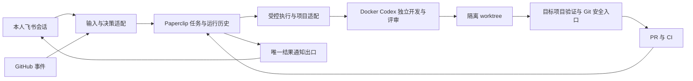

# Paperclip 集成架构

## 组件与数据流

这是目标组件边界，不能据图认定已部署或通过验收。Paperclip 拥有任务和运行历史，适配层仅保存外部事件、执行许可、租约和结果的幂等关联，不建立竞争调度引擎。

## 本仓库实现、运行候选与目标

| 能力 | 本仓库基线 | 实际运行观察 / 目标 |
|---|---|---|
| 固定 Paperclip、PostgreSQL、网关、Docker 与专用卷 | 已有启动、完整性与来源保护代码 | 实际运行候选从独立集成目录启动，必须另核对 |
| 订阅认证与单次 hello | 有只读许可、固定模型、无 API 回退和进程收口 | 旧 hello 证据仅覆盖该请求，不证明业务能力 |
| 飞书、GitHub 与 RWB 执行桥 | 当前主线尚未包含 | 其他集成候选存在实现与运行资产，本轮不覆盖其脏工作区 |
| 宿主磁盘、日限、租约、恢复、Skills 与独立评审 | 当前候选有要求，缺完整业务入口 | 必须核对集成实现和同候选验收，不重复实现第二套控制器 |
| 文档、规则与 CI | 本轮新增 | 独立于真实模型和运行升级留证 |
| 两条 low 档位闭环 | NOT_RUN | 见验收手册及日期状态 |

## Chief 网页续接边界

#261 的网页策略只绑定原任务、文档、PR 和历史输入版本。网页操作使用已认证的 Paperclip 会话、公司成员关系及同源写入检查。自然语言补充由可信 Chief 回合接收。原生回合结束后登记包含消息摘要和调用证据的持久意图。回调独立于 Native 执行锁释放，既有控制器先持久认领操作，再执行原任务补充或原 PR 更新。认领后结果未知时只核对原操作。同一对话代际内，补充在 Native 任务行与当前对话行的锁下按本人消息去重，确认按精确候选及独评摘要去重。暂停与确认通过原 Native repository 的任务行锁串行记录，控制门随 activity ledger 重建。实际发布器在写入前仍须核对控制门、当前 head、同候选检查、权限和租约。操作回执保持可读，新增意图受专项许可有效期约束。原生对话面板走同源只读状态接口，终态必须同时关联本次续接的授权、本人确认、实际发布回执和最新 PR head 的检查。

## 数据、权限与生命周期

- Paperclip 运行镜像由固定平台、基础镜像 digest 和实际构建上下文指纹标识。构建入口只传递已做指纹的源码输入；任务标识、日志、数据和依赖挂载不参与镜像重建。Compose 只消费本机已核对的精确镜像 ID，不隐式构建或拉取。

- PostgreSQL 保存 Paperclip 元数据；外置 APFS 保存数据库、认证、workspace、日志和候选依赖。本仓库只保存代码、规则和脱敏证据摘要。
- 网关面向固定后端，私有认证及精确 Origin 约束；基线是 loopback 8097。Tailscale 或实际其他入口必须单独核实，不能从目标配置推断已启用。
- Codex 通过容器内既有个人订阅，验收固定 `gpt-6.1-sol` / `low`。开发与评审独立会话，限定 workspace，不复制宿主认证或启用 bypass。
- 本项目自身可在全部交付门满足后自动合并；RWB 通过自己的安全入口交付 PR，适配层不能扩大权限。

## 失败传播与恢复

外部输入不授予权限。许可、候选或任务版本不匹配、宿主证据过期、日限耗尽、写者未知、评审或 CI 缺证据均拒绝后续动作。错误必须有稳定代码与脱敏日志。

调用已启动而结果未知时保留原 attempt 和租约，核对 Native run、journal、PR 和通知回执后再决定下一步；不能自动恢复许可、重跑模型或重复发布。CI 等待释放执行资源与重新取得写入许可必须有真实证据。

运行升级需要新派发关闭、任务及进程排空、候选身份和恢复证据。源码、运行、业务、回收四层状态分别记录。见 [运维](operations.md)、[验收](acceptance-runbook.md) 和 [当日观察](governance-status-20261104.md)。

旧接口与自建 SQLite 方案保存在 [历史架构](archive/self-built-architecture.md)，不属于当前公开 API。
