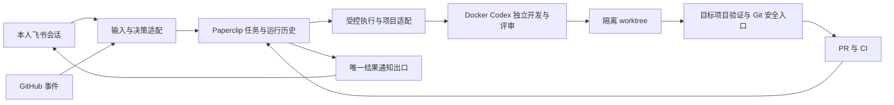

# Paperclip 集成架构

## 组件与数据流

这是目标组件边界，不能据图认定已部署或通过验收。Paperclip 拥有任务和运行历史，适配层仅保存外部事件、执行许可、租约和结果的幂等关联，不建立竞争调度引擎。

## 本仓库实现、运行候选与目标

| 能力 | 本仓库基线 | 实际运行观察 / 目标 |
|---|---|---|
| 固定 Paperclip、PostgreSQL、网关、Docker 与专用卷 | 已有启动、完整性与来源保护代码 | 实际运行候选从独立集成目录启动，必须另核对 |
| 订阅认证与单次 hello | 有只读许可、固定模型、无 API 回退和进程收口 | 旧 hello 证据仅覆盖该请求，不证明业务能力 |
| 飞书入站、Chief 角色协调、受管通知及限定 RWB 入口 | 已有 Native 入站、角色运行与项目适配代码 | 各入口按其精确运行回执认证，旧 RWB 试点不会随 M2 自动启用 |
| 调用预算、恢复、材料与质量验证 | 已有同根预算、操作对账、材料校验和独立 QA 合同 | 离线回归不能证明实际 Skill/工具调用或真实业务完成 |
| 跨项目选择、多轮续接与确认记忆 M2 | 本分支有 catalog、Native 命令、分区记忆及运行接线 | 首轮本地 Docker 515/515 通过，未含后加配置工具；Mini 激活与 M2 真实业务 NOT_RUN |
| 文档、规则与 CI | 已有检查和同步映射 | 源码、远端 CI、运行升级及业务回执分别留证 |

## Chief 网页续接边界

#261 的网页策略只绑定原任务、文档、PR 和历史输入版本。固定镜像提供默认关闭的装配入口及原生对话插件。网页操作使用已认证的 Paperclip 会话、公司成员关系及同源写入检查。自然语言补充由可信 Chief 回合接收。原生回合结束后登记包含消息摘要和调用证据的持久意图。回调独立于 Native 执行锁释放，既有控制器核对授权与共享租约后，在 Native 行锁下持久认领操作，再执行原任务补充或原 PR 更新。认领后结果未知时只核对原操作。同一对话代际内，补充在 Native 任务行与当前对话行的锁下按本人消息去重，确认按精确候选及独评摘要去重。暂停与确认通过原 Native repository 的任务行锁串行记录，控制门随 activity ledger 重建。实际发布器在写入前仍须核对控制门、当前 head、同候选检查、权限和租约。操作回执保持可读，新增意图受专项许可有效期约束。原生对话面板走同源只读状态接口，终态必须同时关联本次续接的授权、本人确认、实际发布回执和最新 PR head 的检查。

## 数据、权限与生命周期

真实 RWB 新任务试点通过独立的原生 Chief 对话接收两轮输入。Paperclip 任务事务保存输入、操作认领、确认和回执。Mac 宿主只消费该实例的私有操作交接，调用独立 Docker 模型会话、共享准入账本和 RWB Git Safety。写入仅覆盖约定文件及同一个 PR，CI 以当前远端 head 为准。

网页新建演练使用独立的 Paperclip 实例。创建入口默认关闭，开启后只识别绑定的演练账户、公司、项目和原生 Chief 对话。任务、初始输入和登记回执在同一个 Paperclip 事务中提交。固定文档执行器从该登记恢复，沿用原操作 ID 记录候选和等待状态，模拟 CI 只匹配该候选。业务控制器、订阅和 GitHub 写入凭据不进入演练网络。

- Paperclip 运行镜像由固定平台、基础镜像 digest 和实际构建上下文指纹标识。构建入口只传递已做指纹的源码输入；任务标识、日志、数据和依赖挂载不参与镜像重建。Compose 只消费本机已核对的精确镜像 ID，不隐式构建或拉取。

- PostgreSQL 保存 Paperclip 元数据；外置 APFS 保存数据库、认证、workspace、日志和候选依赖。本仓库只保存代码、规则和脱敏证据摘要。
- 网关面向固定后端，私有认证及精确 Origin 约束；基线是 loopback 8097。Tailscale 或实际其他入口必须单独核实，不能从目标配置推断已启用。
- Codex 通过容器内既有个人订阅，验收固定 `gpt-6.1-sol` / `low`。开发与评审独立会话，限定 workspace，不复制宿主认证或启用 bypass。
- 本项目自身可在全部交付门满足后自动合并；RWB 通过自己的安全入口交付 PR，适配层不能扩大权限。

## 失败传播与恢复

外部输入不授予权限。许可、候选或任务版本不匹配、宿主证据过期、模型调用额度耗尽、写者未知、评审或 CI 缺证据均拒绝后续动作。错误必须有稳定代码与脱敏日志。

调用已启动而结果未知时保留原 attempt 和租约，核对 Native run、journal、PR 和通知回执后再决定下一步；不能自动恢复许可、重跑模型或重复发布。CI 等待释放执行资源与重新取得写入许可必须有真实证据。

运行升级需要新派发关闭、任务及进程排空、候选身份和恢复证据。源码、运行、业务、回收四层状态分别记录。见 [运维](operations.md)、[验收](acceptance-runbook.md) 和 [当日观察](governance-status-20261104.md)。

旧接口与自建 SQLite 方案保存在 [历史架构](archive/self-built-architecture.md)，不属于当前公开 API。

## 本人飞书 Chief 入站

`/chief <目标>` 通过唯一的既有官方 SDK 长连接进入。固定 app、tenant、本人 open ID 与 Native responsible user 共同限制准入；正文不提供权限覆盖。适配器仅调用 Native issue/heartbeat/activity 服务，消息 ID 与正文摘要在同一事务登记，重复投递复用原任务。唤醒前先持久认领；丢失回执不自动重发。本人已取消或改变版本的旧任务记录为 stale，不能阻塞后来的独立目标。登记回执与成果通知分别去重，未知投递继续保留原记录。

默认关闭的运行入口只在服务主进程装配，不在 CLI 子进程创建第二个监听。Chief 按既有根六次预算规划、创建 Native 子任务及收回成果，全局执行准入继续生效。离线准入/恢复测试与真实本人消息验收分别留证；管理创建的 Native 目标和飞书出站通知不能证明飞书入站。

个人 M1 的旧入口和历史记录保留。M2 开关启用后仍使用同一飞书长连接和 `/chief` 命名空间，通过 Native activity 持久保存当前项目及各项目所选任务；未启用 context 时保留 M1 路径。M2 的项目/状态/记忆查询不创建模型任务。旧 RWB 日常服务、primary workspace 和回调不由此入口恢复或改写；启用前仍须核实唯一监听，不能仅据健康状态推断。

## 跨项目上下文与记忆 M2

部署 catalog 将 Native company、owner、project、规范 workspace 及可选 `projectWorkspaceId` 绑定；flow、operation、子任务、permit 和挂载沿同一绑定派生，原 11 个 Agent ID 与全局默认项目保持。项目选择和本人指令、输入版本、计划、继续意图均以既有 Native 事务/activity 为准；私有文件仅保存知识版本和执行映射，不建立第二个调度器、任务库、WebSocket 或数据库 schema。

`add` 先记录本人补充，活动 run 终态明确后才应用新输入；旧 flow/产物保留原摘要。同任务恢复以全新模型 session 重建授权输入与产物上下文，同根六次额度累计，不重置 lease 或伪造 resume 身份。暂停后同版本继续复用计划；已结束的 blocked 阶段须先对账，重规划至少保留三次调用。done 根的明确新目标仅由 `followup` 建立关联新根，不使用 `parentId`，失败/UNKNOWN 不借此换预算。

新任务仅装载本项目共享和本角色私有的当前 owner-confirmed 记忆，不带其他任务对话历史。`remember`、`correct` 和跨项目 `share` 必须来自实际本人指令；历史/查询不确认新内容。旧知识按授权分区投影为 historical-reference，不能自动升级为本人确认；已有确认身份不会被截断查询外的旧值补回。每 run 只读材料快照固定身份和摘要；跨项目旧 manifest 只有显式 generic 才能复用，任务容器不见其他项目材料、宿主 HOME、Docker socket 或 App 数据库秘密。

普通目标不增加审批。`--plan-first` 是本人一次性选择的计划后暂停，`continue` 即按当前要求继续，无需复制 SHA；原项目的真实发布权限仍适用。命令、配置 preview/apply 和验收边界见[跨项目专题](cross-project-context.md)。通用岗位能力、Managed 指令保存和项目交付各自合同继续保留，M2 不能覆盖其现役配置或历史。
